# Kiến trúc pipeline Steam API

Pipeline chuẩn bị dữ liệu cho Steam Game Recommendation. Luồng chạy bắt đầu từ Steam API và kết thúc ở các bảng batch/stream có thể dùng cho Processing.

```mermaid
flowchart LR
    API[Steam APIs] --> DAG[Airflow crawl]
    DAG --> Bronze[Bronze raw JSON]
    Bronze --> Silver[Silver games reviews interactions]
    Silver --> Gold[Gold thống kê]
    Gold --> Gate[Quality gate]
    Gate --> Outbox[SQLite accepted versions và outbox]
    Outbox --> Kafka[Kafka review_upsert]
    Kafka --> Consumer[Consumer lưu receipt rồi commit]
    Consumer --> Stream[Silver review_versions và reviews_latest]
```

## 1 Data Sources

| Endpoint trên api.steampowered.com | Dữ liệu |
|---|---|
| `IStoreBrowseService/GetItems/v1/` | Catalog của các App ID cấu hình |
| `IUserReviewsService/GetAppReviews/v1/` | Review theo App ID và cursor |

Watchlist chỉ chứa App ID; tên game, metadata và review được lấy khi chạy. Catalog adapter hỗ trợ context US/USD. Review request dùng Updated filter, cả recommend/không recommend và ngôn ngữ cấu hình.

Endpoint review có [tài liệu Steamworks](https://partner.steamgames.com/doc/webapi/IUserReviewsService). Catalog endpoint đã được kiểm tra bằng phản hồi thực tế; schema công khai ít đầy đủ hơn nên adapter kiểm tra cấu trúc trước khi nhận.

## 2 Ingestion và Streaming

DAG `steam_api_batch` chạy `@hourly`, không backfill lịch và chỉ có một active run. Mỗi poll bắt đầu từ cursor đầu. Retry của cùng run tiếp tục sau page đã được lưu; config của run không được đổi khi resume.

HTTP client giới hạn tần suất, có timeout và retry cho lỗi kết nối/5xx/429. Khi có `Retry-After`, client chờ theo header. Page JSON và metadata được lưu trước khi cập nhật checkpoint.

Sau khi chuẩn hóa, pipeline hợp nhất với snapshot trước và chạy quality gate. Accepted review revision và event outbox được ghi trong cùng transaction SQLite. Run có base cũ sẽ bị từ chối nếu một run khác đã commit, thay vì ghi đè snapshot mới.

Publisher gửi topic `steam.reviews.upserts.v2`, key là review ID. Event được đánh dấu sent sau ACK. Consumer group `steam-api-bronze-v2` lưu receipt hoặc quarantine trước khi commit offset. Delivery có thể lặp khi retry; event ID ổn định theo review ID và revision dùng để loại trùng.

Lần đầu quan sát một review tạo upsert dù review đã được đăng từ trước. Votes và lifetime playtime thay đổi riêng không tạo revision mới; các trường quyết định revision được định nghĩa trong data contract.

## 3 Storage

Mọi đường dẫn dưới đây nằm trong `data/steam_api/`.

| Đường dẫn | Nội dung |
|---|---|
| `bronze/api/<run_id>/` | Raw JSON, metadata HTTP và checksum |
| `silver/<run_id>/` | Games, reviews, interactions Parquet |
| `gold/<run_id>/` | Thống kê review theo game |
| `bronze/kafka/<topic>/<partition>/` | Receipt theo offset |
| `silver/stream/` | Các phiên bản review và bản mới nhất |
| `manifests/`, `quarantine/` | Lineage/checkpoint và dữ liệu lỗi |
| `state.sqlite` | Run đã commit, latest run, review revision và outbox |
| `latest.json` | File trỏ tới snapshot đã commit |

SQLite là nguồn trạng thái commit; `latest.json` được cập nhật từ trạng thái đó. Xác minh lại run cũ không làm lùi latest run. Parquet được ghi qua file tạm và thay thế sau khi ghi hoàn tất.

## Bàn giao và giới hạn

Silver giữ cả review tiêu cực và feedback của review rỗng. Gold chỉ chứa thống kê mô tả; chưa có ABSA prediction, aspect profile hay kết quả recommendation.

Crawl có giới hạn số dòng mỗi game, chưa có full-history backfill hoặc phát hiện review bị xóa. Metadata giá, vote và lifetime playtime là quan sát lúc crawl, không mặc nhiên là thông tin tại ngày review. Xem [data contract](DATA_CONTRACT.md) trước khi xây feature hoặc temporal split.
