# Kế hoạch Steam Game Recommendation từ Steam API

Mục tiêu của ba phần đầu là lấy dữ liệu trực tiếp từ Steam, đưa qua batch và Kafka, lưu được nguồn gốc và dữ liệu sạch để bàn giao cho nhóm Processing. Ưu tiên một luồng nhỏ chạy được trong ngày; chưa đánh giá chất lượng recommendation.

## Phần 1 Data Sources

Nguồn chính là hai endpoint trên `https://api.steampowered.com`, không cần dataset tải sẵn:

| API | Phạm vi | Dữ liệu |
|---|---|---|
| IStoreBrowseService/GetItems/v1 | Danh sách App ID cấu hình | Tên, mô tả, developer/publisher, tag/category ID, free flag, lựa chọn mua và giá |
| IUserReviewsService/GetAppReviews/v1 | Reviews theo App ID, cursor | Review ID, tác giả, text, recommend, ngôn ngữ, created/updated time, playtime và cờ nguồn |

Chọn 5 game từ nhiều kiểu trải nghiệm: CS2, Dota 2, Stardew Valley, Cyberpunk 2077 và ELDEN RING. App ID là watchlist đầu vào; metadata và review đều được lấy từ API khi chạy, không hardcode tên hoặc nội dung review vào kết quả.

Mặc định tiếng Anh, tối đa 200 review/game/poll, 100 review/trang, sort Updated. Context giá US/USD được cấu hình rõ. API catalog trả tag/category ID; không tự đặt tên genre cho các ID đó. API review dùng `recommendationid` thật thay cho khóa tự sinh từ ngày đăng.

Không thu thập click, wishlist, giỏ hàng hoặc giao dịch mua. `steam_purchase` là cờ trên review, không phải log purchase có thời điểm giao dịch. Các giá trị playtime cũng là quan sát do review API trả về, không phải session log.

**Đầu ra và nghiệm thu:** raw JSON trực tiếp từ Steam, request metadata, checksum, schema mapping và số lượng thực tế theo từng game. API key không được yêu cầu trong cấu hình demo. [Tài liệu review](https://partner.steamgames.com/doc/webapi/IUserReviewsService).

## Phần 2 Ingestion và Streaming

```mermaid
flowchart LR
  A[Steam APIs] --> B[Airflow crawl]
  B --> C[Bronze raw JSON và cursor]
  C --> D[Silver normalize và upsert]
  D --> E[Gold thống kê và quality gate]
  E --> F[SQLite review state và outbox]
  F --> G[Kafka review_upsert]
  G --> H[Consumer lưu receipt rồi commit]
  H --> I[Bronze Kafka]
  I --> J[Silver stream versions và latest]
```

DAG `steam_api_batch` chạy mỗi giờ, `catchup=False`, một active run và retry một lần. Task `crawl_steam` dùng run ID ổn định của DAG; retry cùng run tiếp tục các page chưa hoàn tất. Những lần poll mới luôn bắt đầu cursor đầu tiên để quan sát các review được cập nhật gần đây.

HTTP client giới hạn khoảng một request/giây, timeout 30 giây, retry tối đa ba lần với backoff cho lỗi kết nối/5xx và xử lý Retry-After khi gặp 429. Mỗi page lưu raw và metadata trước khi cập nhật cursor; không cần crawl lại toàn bộ run khi mất kết nối ở page sau.

Silver giữ review ID duy nhất, chọn bản có updated time mới hơn, rồi hợp nhất với snapshot thành công trước đó. Quality gate kiểm tra checksum, foreign key, số lượng, UTC timestamps và thống kê positive/negative trước khi tạo event.

Trong cùng một SQLite transaction, quality task cập nhật accepted review revision và hàng đợi outbox. Publisher gửi topic `steam.reviews.upserts.v2`, key là review ID, ACK all và chỉ đánh dấu sent sau ACK. Lần crawl đầu phát upsert cho những review hệ thống lần đầu quan sát; những lần poll sau không phát lại review không đổi.

Consumer group `steam-api-bronze-v2` chỉ commit Kafka offset sau khi lưu receipt hoặc quarantine. Raw receipt giữ partition/offset; Silver có bảng version và latest theo review ID. Broker ACK trước khi outbox ghi sent vẫn có thể tạo duplicate delivery sau crash; event ID ổn định giúp consumer loại trùng.

**Đầu ra và nghiệm thu:** DAG dùng API thật chạy thành công; dữ liệu mới qua Kafka; poll lặp không tăng event cho review không đổi; test cập nhật review tạo thêm đúng một version; lỗi publish giữ event chờ gửi lại.

## Phần 3 Storage

| Tầng | Dữ liệu | Quy tắc |
|---|---|---|
| Bronze API | Raw HTTP JSON, metadata request, checksum | Giữ nguyên byte; phân theo run |
| Silver batch | Games, reviews, feedback từ review | App ID/review ID đúng kiểu; review upsert; UTC timestamp |
| Gold | Review counts và positive ratio theo game | Thống kê mô tả của snapshot |
| Bronze Kafka | Envelope + partition/offset + ingest time | Lưu trước commit offset |
| Silver stream | Review versions và latest review | Dedup logical event, giữ phiên bản cập nhật |
| Metadata | Manifest + SQLite | Cursor, lineage, accepted revision, outbox và run status |

Filesystem và Parquet đủ cho demo. Chưa có transaction/time travel của Iceberg; `latest.json` là điểm chọn snapshot đã qua kiểm tra. Toàn bộ dữ liệu được đặt trong `data/steam_api/` và dùng định danh Steam nhất quán.

Làm sạch cụ thể: chuẩn hóa Unicode/newline, bỏ ký tự điều khiển lỗi, trim; HTML mô tả game sang plain text; chuyển Unix timestamps thành Arrow timestamp UTC; ID thành string; thiếu playtime giữ null; giữ recommended=false; review rỗng giữ nhưng không đưa vào ABSA. Giá free-to-play là 0, không lấy giá gói nâng cấp làm giá game miễn phí.

Gold hôm nay chưa có ABSA/profile hoặc ma trận huấn luyện. Nhóm Processing sẽ bổ sung những bảng đó theo `DATA_CONTRACT.md`. Lifetime playtime, vote và giá là dữ liệu ở thời điểm crawl, không tự coi là giá trị lịch sử tại thời điểm review.

**Đầu ra và nghiệm thu:** raw đối chiếu được với Silver; số lượng có giải thích; không duplicate review ID; có quarantine và lý do; giữ được snapshot trước và lineage đến page nguồn.

## Lịch thực hiện trong ngày

| Thời lượng dự kiến | Công việc | Đầu ra |
|---|---|---|
| 30 phút | Kiểm tra endpoint, mạng và schema thật | Phản hồi live của catalog/review |
| 60 phút | Crawler, pagination, retry và checkpoint | Bronze API và manifest |
| 90 phút | Chuẩn hóa, upsert và quality gate | Silver/Gold + báo cáo |
| 60 phút | Outbox, Kafka publisher và consumer | Review upsert đến Silver stream |
| 30 phút | DAG và lịch poll | Airflow run thành công |
| 30 phút | Kiểm chứng, tài liệu, bàn giao | Source và bằng chứng API thật |

Giới hạn có chủ ý: đây là cửa sổ cập nhật gần nhất có trần số dòng, không phải full backfill. Khi một game có nhiều cập nhật hơn trần giữa hai lần poll, có thể bỏ sót. Muốn tăng độ phủ cần tăng limit/giảm chu kỳ hoặc crawl đến watermark với overlap và đo coverage. Demo không khẳng định có toàn bộ lịch sử hoặc phát hiện review đã xóa.

Tăng quy mô sau nghiệm thu: mở rộng watchlist và backfill, đo API quota, chuyển Spark vào bước chuẩn hóa nếu dữ liệu lớn, rồi cân nhắc object storage/Iceberg. Nguồn gốc và contract hiện tại vẫn giữ để nhóm sau nối tiếp được.
