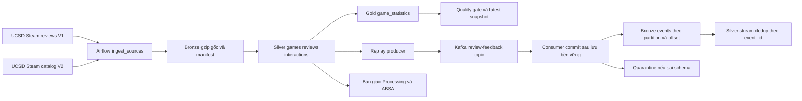

# Kế hoạch triển khai Steam Game Recommendation trong một ngày

Phạm vi phụ trách là ba tầng đầu trong `Architect.docx`: Data Sources, Ingestion & Streaming và Storage. Đầu ra cần đủ rõ và sạch để nhóm Processing có thể chạy ABSA, tạo đặc trưng và huấn luyện recommendation ở bước tiếp theo.

Mục tiêu hôm nay là chứng minh dữ liệu Steam thật đi được từ nguồn đến các bảng lưu trữ, có chạy batch bằng Airflow, truyền sự kiện qua Kafka, kiểm tra chất lượng và chạy lại có kiểm soát. Đây là demo kỹ thuật cho môn học; kết quả này chưa chứng minh chất lượng gợi ý game.

## Phạm vi và lựa chọn công nghệ

| Thành phần | Chọn cho hôm nay | Vai trò |
|---|---|---|
| Ngôn ngữ | Python | Download, chuẩn hóa và kiểm tra dữ liệu |
| Batch orchestration | Apache Airflow standalone | DAG 4 task, dependency, retry và log |
| Streaming | Apache Kafka một broker KRaft | Producer, topic, consumer group và offset |
| File lưu trữ | Gzip gốc, JSON và Parquet | Bronze bất biến theo checksum; Silver chuẩn hóa; Gold thống kê |
| Run metadata | Manifest JSON và SQLite | Nguồn, checksum, snapshot, số dòng, trạng thái |
| Triển khai | Docker Compose | Cùng môi trường chạy và một project riêng |

Kafka và Airflow là hai công nghệ được chọn để đáp ứng định hướng môn học. Chưa cần Spark/Hadoop cho mẫu dữ liệu hôm nay. Nếu giảng viên bắt buộc một trong hai công nghệ đó, thay bước Silver bằng Spark local, giữ nguyên contract dữ liệu và tiêu chí nghiệm thu.

Storage hôm nay dùng filesystem local có bind mount. Đây là Data Lake demo, chưa có object storage hay table format ACID. Tài liệu gốc gợi ý MinIO, nhưng repository community hiện đã archive; khi cần S3 local có thể khảo sát SeaweedFS. [MinIO](https://github.com/minio/minio), [SeaweedFS](https://github.com/seaweedfs/seaweedfs).

## Sơ đồ luồng dữ liệu



### Phần 1 Data Sources

Nguồn chính là bộ Steam của UCSD. Chọn V1 reviews vì có định danh người dùng trong dataset, nội dung review và cờ `recommend`; ghép thông tin game từ catalog V2 bằng Steam App ID. Đây là lựa chọn hai file cụ thể, không gộp định danh người dùng giữa các phiên bản dataset. [Nguồn UCSD và tài liệu trích dẫn](https://cseweb.ucsd.edu/~jmcauley/datasets.html#steam_data).

| File | Nội dung dùng | Đích |
|---|---|---|
| `australian_user_reviews.json.gz` | user_id, reviews.item_id, review, recommend, posted | reviews và interaction được suy ra từ review |
| `steam_games.json.gz` | id, title/app_name, genres, tags, developer, publisher, price | games |

Quy mô demo mặc định: đọc tối đa 5.000 review nguồn và catalog. Mẫu là các dòng đầu tiên theo thứ tự file, nên chỉ dùng kiểm chứng pipeline; không dùng để kết luận chất lượng recommendation. Có thể chạy toàn bộ reviews V1 bằng `--limit 0` sau khi demo đạt.

Các việc cần làm:

1. Tải file, giữ nguyên gzip gốc, ghi URL, SHA-256 và thời điểm ingest.
2. Đọc thử schema thực tế. Các file này có dòng dạng Python dict literal, nên dùng `ast.literal_eval`, không dùng `eval`.
3. Chuẩn hóa App ID thành string; hash user key và đặt namespace `ucsd_v1`.
4. Ghi `recommended` là boolean. Không quy đổi thành rating 1–5, không coi mọi review là tín hiệu tích cực.
5. Giữ nguyên review âm và các review thiếu thời gian. Thiếu năm không được tự đoán năm; đánh dấu thời gian chưa biết.

Không có click/view/wishlist thật trong hai file được chọn. Demo streaming replay feedback thật có sẵn, luôn có `source_mode=replay`; không tạo nhận định đây là hành vi mới trên Steam.

API Steam là phần mở rộng sau demo: polling review mới cho danh sách App ID hữu hạn, có cursor/checkpoint và retry. Tài liệu hiện dùng `IUserReviewsService/GetAppReviews`, thay cho endpoint `/appreviews` cũ. API này không phải nguồn push event trực tiếp. [Steamworks](https://partner.steamgames.com/doc/webapi/IUserReviewsService).

**Nghiệm thu phần 1:** có hai file nguồn, schema mapping, nguồn trích dẫn và báo cáo tỷ lệ join/null/thời gian thiếu; không trộn user identity hoặc bịa dữ liệu thiếu.

### Phần 2 Ingestion và Streaming

Luồng batch qua DAG `steam_batch`:

```text
ingest_sources → silver → gold → quality_gate
```

`ingest_sources` tải hoặc dùng cache, lưu Bronze theo checksum và sinh snapshot ID. `silver` làm phẳng reviews, chuẩn hóa khóa và dữ liệu, gom bản trùng, đưa bản ghi không hợp lệ vào quarantine. `gold` sinh thống kê game. `quality_gate` đối chiếu số lượng và khóa, kiểm checksum rồi mới xuất `latest.json`.

DAG có lịch `@daily`, `catchup=False`, một run hoạt động cùng lúc, retry một lần. Trong hôm nay trigger thủ công và chụp một run thành công. Đây là ingest lại snapshot tĩnh có kiểm soát, chưa phải incremental API ingestion.

Luồng Kafka có một topic `steam.review-feedback.v1`, một partition, replication factor 1 và retention 24 giờ. Dùng cấu hình này để tiết kiệm tài nguyên cho demo, không tuyên bố có high availability.

1. Đọc 200 review đã sạch từ snapshot hoàn tất.
2. Producer tạo event ID ổn định từ review ID và gửi Kafka với `acks=all`.
3. Consumer validate contract, lưu raw envelope theo `(topic, partition, offset)` vào Bronze.
4. Consumer chỉ commit offset sau khi lưu toàn bộ batch vào Bronze hoặc quarantine. Crash trước commit có thể đọc lại; ghi cùng offset không làm mất lịch sử nguồn.
5. Export Bronze event thành Parquet, loại trùng theo logical `event_id`.
6. Phát lại cùng 200 event: Bronze có thêm receipt, Silver vẫn có 200 logical event.

`event_time` là thời điểm lịch sử trong review; `produced_at` là lúc replay; `ingested_at` là lúc consumer nhận và lưu. Không dùng chênh lệch `ingested_at - event_time` làm độ trễ streaming vì dữ liệu lịch sử đã cũ.

Contract JSON nằm trong `contracts/`. Bản demo dùng validation trong code và `schema_version=1`; chưa triển khai service Schema Registry riêng.

**Nghiệm thu phần 2:** một DAG thật chạy thành công; 200 event qua broker thật và được lưu; replay không tăng số logical event; restart consumer tiếp tục theo committed offset; payload sai bị quarantine.

### Phần 3 Storage

```text
data/
  downloads/                         cache file nguồn
  bronze/files/<sha256>/             gzip gốc
  bronze/events/<topic>/<partition>/ receipt theo Kafka offset
  silver/<snapshot_id>/              games reviews interactions Parquet
  silver/stream/                     event Parquet sau dedup
  gold/<snapshot_id>/                game_statistics Parquet
  manifests/<snapshot_id>.json       lineage config checksum row counts
  quarantine/                       dữ liệu lỗi và lý do
  metadata.sqlite                   run metadata
  latest.json                       snapshot đã qua quality gate
```

| Bảng | Một dòng đại diện | Khóa | Mục đích |
|---|---|---|---|
| Silver games | Một game | item_id | Content metadata cho bước sau |
| Silver reviews | Một review trong nguồn | review_id suy ra ổn định | Review text cho ABSA và feedback |
| Silver interactions | Một feedback từ review | event_id bằng source review ID | Tín hiệu user–item có provenance |
| Silver stream feedback | Một logical replay event | event_id UUID | Kiểm chứng consumer và dedup |
| Gold game_statistics | Thống kê của game trong snapshot | snapshot_id, item_id | Đối chiếu số dòng và demo truy vấn |

Gold hôm nay chỉ là thống kê mô tả của mẫu review. User/item aspect profile và feature ABSA thuộc phần 4; nhóm phụ trách phần đó sẽ ghi thêm Gold dựa trên contract bàn giao. Không coi `game_statistics` là feature đã bảo đảm point-in-time correctness cho huấn luyện.

Chưa partition theo user hoặc item để tránh quá nhiều file nhỏ. Khi tăng quy mô có thể partition theo ngày ingest/event nếu thực sự hữu ích, compact các event file và chuyển sang Iceberg. Snapshot/manifest hiện tại không cung cấp transaction hoặc time travel của Iceberg.

**Nghiệm thu phần 3:** giữ được nguồn gốc; đọc được Parquet; khóa duy nhất; không còn orphan item trong bảng sạch; chạy lại không nhân số logical record; phân biệt file dữ liệu với metadata quản lý run.

## Lịch làm việc trong ngày

Ước lượng dưới đây là thời lượng làm việc, không phải cam kết giờ đồng hồ. Pull image và tốc độ mạng có thể chi phối phần dựng môi trường.

| Khung | Việc làm | Đầu ra phải có |
|---|---|---|
| 0–45 phút | Chốt schema, tải và profile hai file | Source mapping và Bronze gốc |
| 45–120 phút | Script batch, Silver, quarantine và manifest | Chạy end-to-end được bằng CLI |
| 120–180 phút | Docker và Airflow DAG | DAG 4 task thành công |
| 180–240 phút | Kafka topic, producer, consumer, export | 200 event được lưu thành Parquet |
| 240–300 phút | Replay, restart, malformed event và đối chiếu | Báo cáo chất lượng và recovery |
| 300–360 phút | README, contract bàn giao và demo | Bộ source + bằng chứng để trình bày |

Nếu thiếu thời gian: giữ nguyên Kafka, Airflow và ba tầng storage; giảm số review và bỏ API live/object storage. Nếu môi trường Docker lỗi kéo dài, báo rõ giới hạn và giữ bản CLI để kiểm tra dữ liệu; không gọi CLI là bằng chứng Airflow/Kafka đã chạy.

## Kiểm tra và bằng chứng trình bày

- Batch: source count = Silver count + duplicate count + rejected count.
- Gold: tổng review_count bằng số review Silver; positive + negative bằng tổng.
- Integrity: sửa một byte Bronze phải bị checksum gate phát hiện.
- Idempotency: chạy lại cùng nguồn/config giữ cùng snapshot ID và một run metadata.
- Streaming: produce 200, consume 200, export 200; replay và export vẫn 200.
- Recovery: sau consumer commit, chạy lại không đọc lại các offset đã commit.
- Bad payload: gửi event sai contract; consumer lưu quarantine thay vì ghi vào Silver.
- Evidence: file báo cáo có số thực, lệnh chạy, phiên bản và trạng thái DAG; screenshot Airflow nếu cần nộp.

## Bàn giao cho Processing

`reviews.parquet` cung cấp review text, user/item key, nhãn recommended và chất lượng thời gian. `games.parquet` cung cấp tags/genres/title. `interactions.parquet` ghi rõ đây là feedback từ review, không phải log click hay mua hàng độc lập; tránh tính cùng tín hiệu hai lần khi hợp nhất dữ liệu.

Những review không có năm được giữ cho xử lý văn bản nhưng phải loại khỏi bài toán yêu cầu temporal split hoặc có chiến lược riêng được báo cáo. Thời gian dạng ngày dùng UTC làm quy ước lưu trữ và có đánh dấu `day_assumed_utc`, không khẳng định timezone gốc của tác giả. Catalog là snapshot lịch sử riêng, không tự bảo đảm giá/metadata tại thời điểm review. Giá giữ ở `price_raw` cho đến khi xác nhận được currency.

Sau khi phần 1–2–3 đạt: nhóm tiếp theo định nghĩa aspect game như gameplay, story, graphics, performance, controls, multiplayer và price/value, chạy ABSA rồi tạo feature/profile. Chưa triển khai thuật toán recommendation trong phần việc hôm nay.
